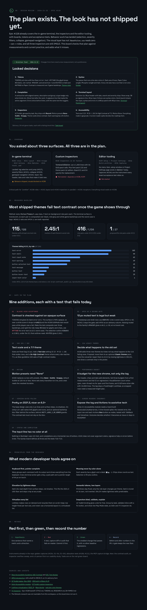
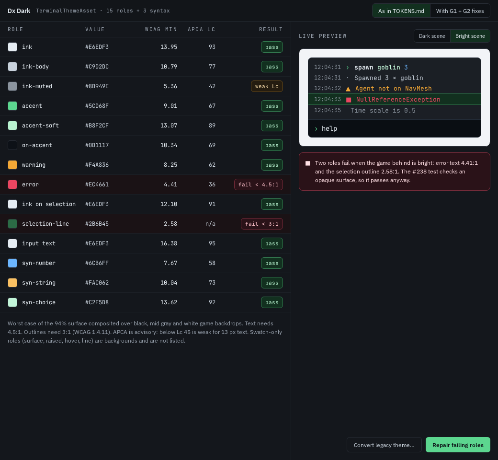
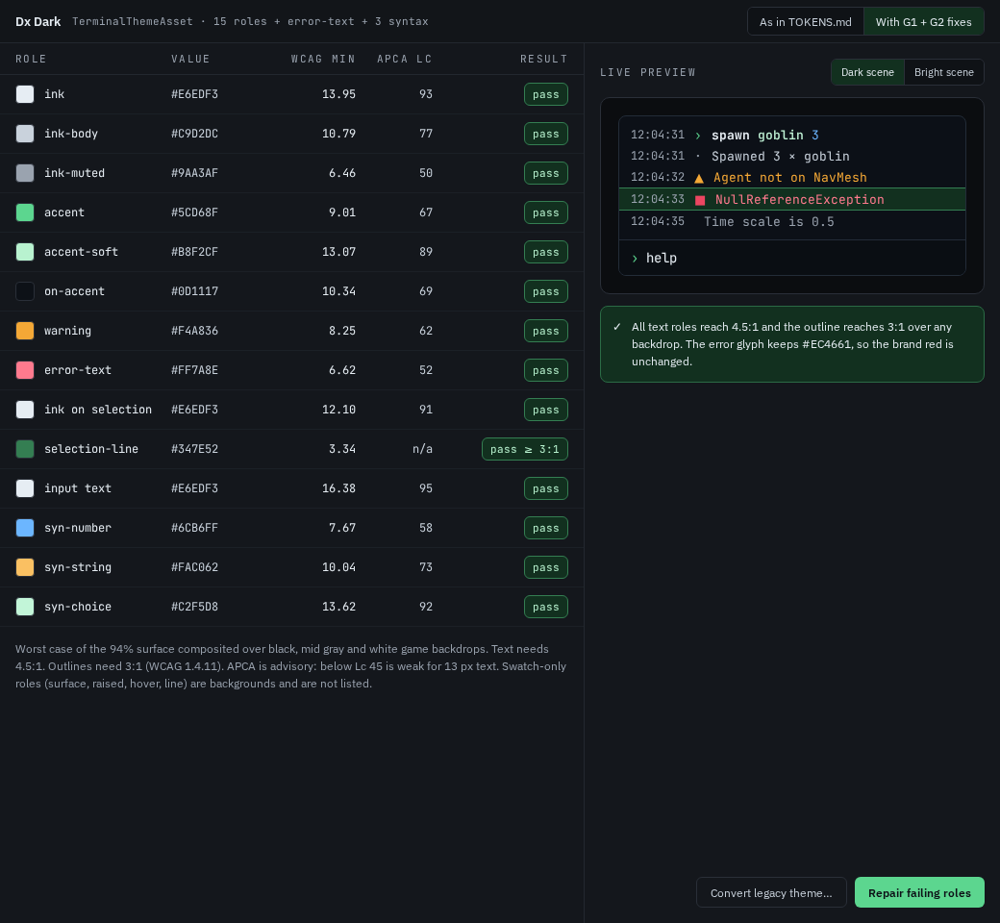
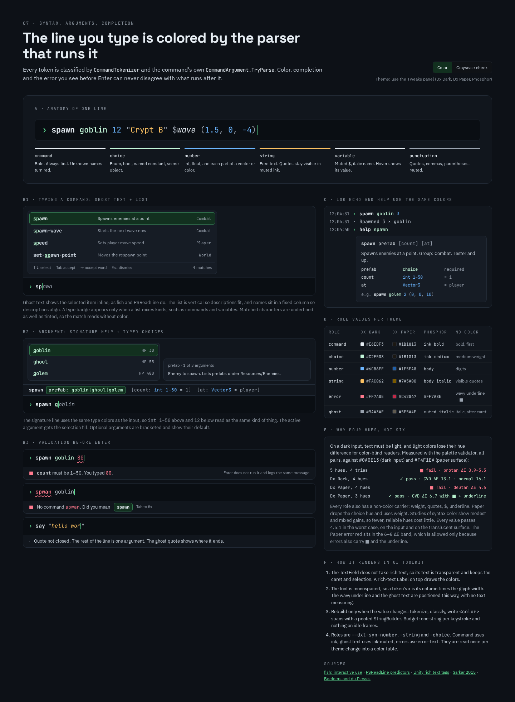
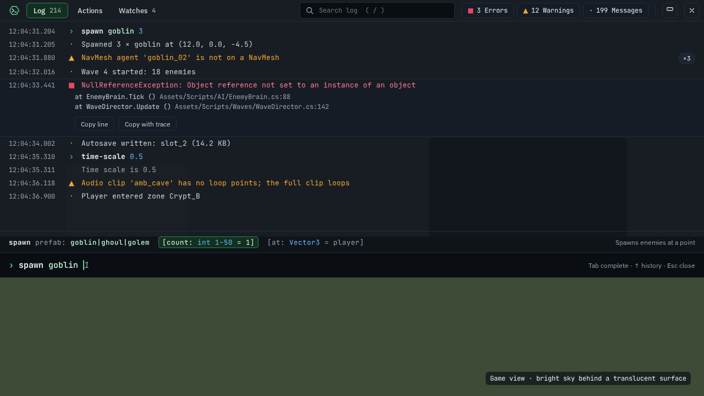
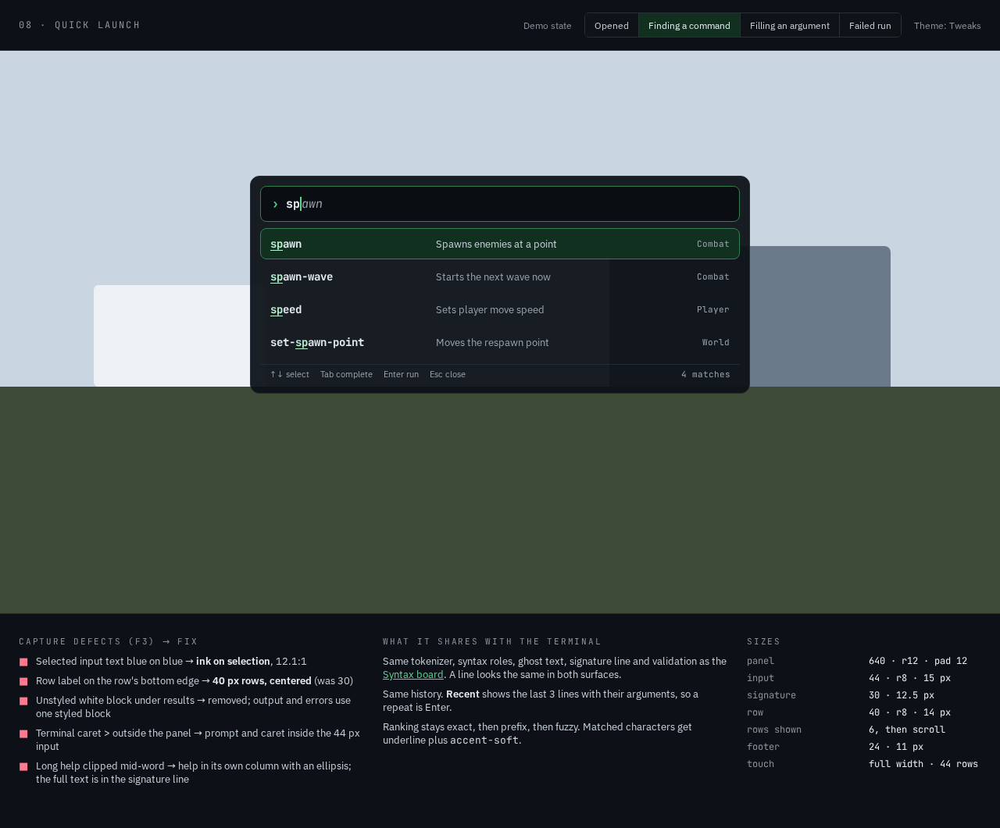
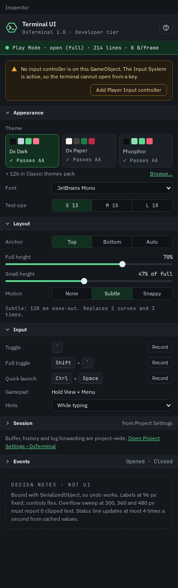
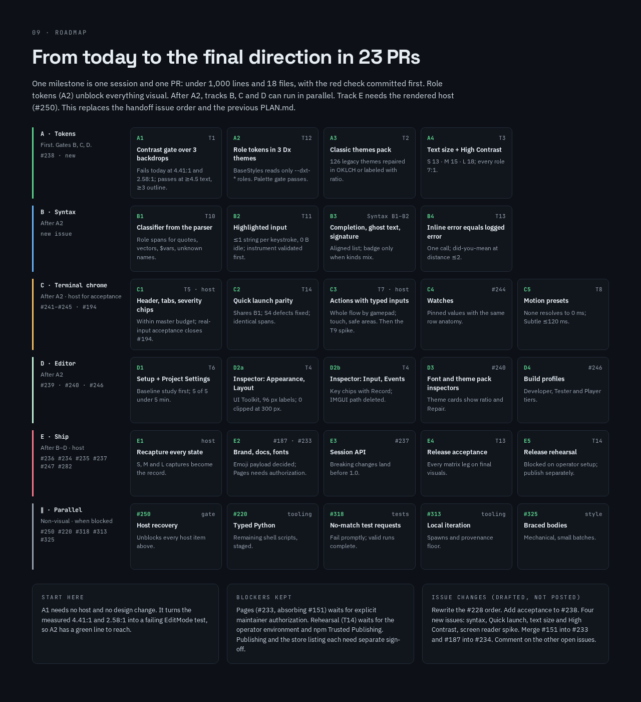

# DxTerminal design overhaul: final direction (2026-11-22)

This is the source of truth for the visual and interaction work in epic #228. It needs no local state and no chat history.
It extends the original handoff, which is in [`handoff/`](handoff/) and attached to #228. Where the two disagree, this file wins.

- **Captures** of every board and state: [`captures/`](captures/).
- **Boards** as static HTML: [`boards/`](boards/). Download a board and open it in a browser; the fonts load from Google Fonts.
- **Board sources** (`*.dc.html`, interactive in the design canvas): [`source/`](source/). Re-render them with [`tools/render/`](tools/render/).
- **Measurements**: [`data/`](data/), reproduced with [`tools/contrast_audit.py`](tools/contrast_audit.py).

Contents: 1 Locked decisions · 2 Measured baseline · 3 Tokens · 4 Syntax and completion · 5 Terminal layout · 6 Quick launch · 7 Inspectors and editor · 8 Accessibility · 9 Performance · 10 Red-green tasks · 11 Milestones · 12 Tools · 13 Sources

## 1. Locked decisions

Changing any of these needs a new measurement, not a preference.

| # | Area | Decision |
| --- | --- | --- |
| 1 | Tokens | The TOKENS.md roles with four fixes: `error-text` #FF7A8E (glyphs keep #EC4661); `ink-muted` #9AA3AF; `selection-line` #347E52 Dark and #4F9068 Paper; an `error-line` role. Contrast is measured over 3 game backdrops. |
| 2 | Syntax | The parser that runs a line also colors it. Dark uses 4 hues, Paper uses 3 plus weight, Phosphor uses weight and italic. Every role also has a cue that is not color. |
| 3 | Completion | Vertical list: aligned names, description, group. A type badge appears only when kinds mix. Ghost text after the caret, a signature line marking the active argument, and errors before Enter with the same text the log gets. |
| 4 | Terminal layout | Direction 1a: 38 px header with tabs, search and severity chips; rows wrap; 30 px signature line; 44 px input; echoes use syntax colors. Quick launch shares the input, syntax and errors in a 640 px panel with 40 px rows. |
| 5 | Inspectors | UI Toolkit, grouped by task. Key chips with **Record**. Motion presets None · Subtle · Snappy. Theme cards show contrast. Each warning has a fix button. |
| 6 | Accessibility | Text size S 13 · M 15 · L 18. Dx High Contrast at 7:1. Motion None. Everything reads in grayscale. A screen reader spike decides the roadmap item. |

## 2. Measured baseline (master, 2026-11-22)

Method: every `Styles/Themes/*.uss` class and 9 text-on-background role pairs each. The terminal surface is translucent, so each pair is composited over black, mid gray (128) and white backdrops, and the worst case is kept. Data: [`data/current.json`](data/current.json).

| Metric | Value |
| --- | --- |
| Themes with at least one text role under 4.5:1 | **115 of 126** |
| Median of each theme's worst role | **2.45:1** |
| Role pairs under 4.5:1 | **416 of 1,134** (211 under 3:1) |
| Themes with a role under APCA Lc 60 | 125 of 126 |
| Proposed Dx role pairs under 4.5:1 (before the fixes) | 1 of 27 |

Most failing roles: `text-error` (103 themes), `text-shell` (99), `text-input-echo` (62), `text-warning` (49), `button-selected-text` (45), `text-message` (21), `button-text` (18), `button-hover-text` (15), `input-text-color` (4).

Other facts on master:
- `Styles/BaseStyles.uss` reads 18 widget-named variables (`--button-bg`, `--text-shell`, ...) and no `--dxt-*` role.
- `Editor/CustomEditors/TerminalUIEditor.cs` is 1,400 lines of IMGUI. `TerminalFontPackEditor.cs` is 266 and `TerminalThemePackEditor.cs` is 183.
- Nothing in `Runtime/` uses rich text on the input. Completions are a horizontal row of buttons.
- `CommandPaletteUI` defaults are `width` 640, `verticalPosition` 0.3, `maxVisibleRows` 6, `rowHeight` 30 and `toggleHotkey` "ctrl+space".
- Already landed: header search and narrow controls (#319), log selection, jump and lifecycle events (#317), severity filters (#321), collapse and safe placement (#323), gamepad navigation and current-match markers (#324), clipboard writes (`TerminalClipboard`).

Current shipped look, from the handoff captures: [terminal](handoff/reference/captures/terminal-full-errors.png), [Quick launch](handoff/reference/captures/palette.png), [long help](handoff/reference/captures/palette-wide-long-help.png), [inspector](handoff/reference/captures/inspector.png).

## 3. Tokens

### 3.1 Contrast rule (gate)

- The surface is translucent. **Every** check composites the surface over black, mid gray (128,128,128) and white and keeps the worst case. Checking against an opaque surface is wrong: it passes Dx Dark error text at 5.0:1 while players over a bright scene see 4.41:1.
- Text roles need ≥4.5:1 (WCAG 1.4.3). Outlines and focus lines need ≥3:1 (WCAG 1.4.11). Dx High Contrast needs ≥7:1 on every text role (Xbox Accessibility Guideline 102).
- APCA Lc is reported as advisory only (it is a WCAG 3 draft). Below Lc 45 is "weak" for 13 px text.
- The 6.3+ backdrop blur must not be counted: the gate assumes no blur.

### 3.2 Roles

These are the 15 TOKENS.md roles, with `error` split into `error` (glyphs and chips) and `error-text`, plus `error-line`. That makes 17 roles and 3 syntax roles. In USS each is `--dxt-<role>`, for example `--dxt-ink-muted`. Bold values changed from TOKENS.md.

| Role | Dx Dark (default) | Dx Paper | Phosphor | Used for |
| --- | --- | --- | --- | --- |
| `surface` | `rgba(13,17,23,.94)` | `rgba(244,241,234,.97)` | `rgba(7,17,11,.96)` | Terminal and palette background |
| `surface-raised` | `#161C25` | `#FAF8F3` | `#0C1A11` | Chips, cards, expanded rows, active chips |
| `hover` | `#1D2530` | `#EFEBE1` | `#12251A` | Hover on rows, chips, buttons |
| `input` | `#0A0E13` | `#FFFFFF` | `#050C08` | Input row and fields |
| `line` | `#232C38` | `#E4DFD1` | `#1A3324` | 1 px separators and borders |
| `ink` | `#E6EDF3` | `#1B1813` | `#C8F7D9` | Input text, selected text, titles, command names |
| `ink-body` | `#C9D2DC` | `#46423A` | `#8FE3B0` | Message rows, button text |
| `ink-muted` | **`#9AA3AF`** | `#5F5A4F` | **`#5FB383`** | Timestamps, system rows, help, ghost text, punctuation |
| `accent` | `#5CD68F` | `#1F7A47` | `#5CD68F` | Prompt, caret, focus, primary fill |
| `accent-soft` | `#B8F2CF` | `#23704A` | `#B8F2CF` | Matched characters |
| `on-accent` | `#0D1117` | `#FFFFFF` | `#07110B` | Text on the accent fill |
| `selection` | `#12301F` | `#DCEFE3` | `#143D26` | Selected row, tab, argument |
| `selection-line` | **`#347E52`** | **`#4F9068`** | `#2F7A4F` | Selected outline (≥3:1) |
| `warning` | `#F4A836` | `#9A5B00` | `#F4B04A` | Warning rows, glyph and chip |
| `error` | `#EC4661` | `#C42847` | `#FF5C74` | Error glyph ■ and chip glyph only |
| **`error-text`** | **`#FF7A8E`** | **`#C42847`** | **`#FF7A8E`** | Error row text, inline error values |
| **`error-line`** | **`#B4445A`** | **`#C4677A`** | **`#B4445A`** | Border of an inline error block |
| `syn-number` | `#6CB6FF` | `#1F5FA8` | = `ink-body` | Numbers, vector and color parts |
| `syn-string` | `#FAC062` | `#7A5A00` | = `ink-body`, italic | Free text |
| `syn-choice` | `#C2F5D8`, weight 500 | = `ink`, weight 600 | = `ink`, weight 500 | Enum, bool, named constant, scene object |

Worst cases over the three backdrops, Dx Dark: `ink` 13.95, `ink-body` 10.79, `ink-muted` 6.46 (Lc 50), `accent` 9.01, `warning` 8.25, `error-text` 6.62, `syn-number` 7.67, `syn-string` 10.04, `syn-choice` 13.62, `selection-line` 3.34 (outline). The two Dx Dark failures in TOKENS.md as written are `error` as text (4.41:1) and `selection-line` #2B6B45 (2.58:1). The Paper selection line was 1.64:1 at #8CC5A3. Data: [`data/dx.json`](data/dx.json).

The old variable-to-role mapping is TOKENS.md Part 2 ([`handoff/production/TOKENS.md`](handoff/production/TOKENS.md)). One change: `--text-error` maps to `error-text`, not `error`.

### 3.3 Legacy themes

The 126 classes in `Styles/Themes/` move to an optional **Classic themes** pack. A converter repairs each failing role to 4.5:1 by moving only OKLCH lightness, which keeps the hue. A theme it cannot repair keeps its colors and shows its worst ratio in the picker. Classic themes are not shipped as defaults. A sheet with only the old variables still loads, with one log line (#238).

### 3.4 Syntax palette gate

Every syntax pair, measured on `input` and on the composited surface, must reach CVD ΔE ≥8 (OKLab ×100, protan, deutan and tritan). The 6–8 band is allowed only with a second cue. The normal-vision ΔE must be ≥15. Results: Dx Dark with 4 hues passes (CVD 13.1, normal 16.1). Five hues fail (protan 0.9–5.5). Dx Paper with 4 hues fails (deutan 4.6), so Paper drops the choice hue and uses weight. Paper with 3 hues reaches 6.7, allowed because errors also carry ■ and an underline.

## 4. Syntax and completion

Paper: [captures/syntax-paper.png](captures/syntax-paper.png) · Phosphor in grayscale: [captures/syntax-phosphor-gray.png](captures/syntax-phosphor-gray.png)

### 4.1 Classification

Classify a line with `CommandTokenizer.Tokenize` (token `Start`, `End`, `StartQuote`, `EndQuote`) and, for argument tokens, the command's own `CommandArgument` (`TryParse`, `ValidateParsed`, `TypeName`, `HasChoices`). Do not use a regex. Execution and coloring must split the same line into the same arguments.

| Role | Applies to | Color | Cue that is not color |
| --- | --- | --- | --- |
| command | token 0 when it names a registered command | `ink`, bold | bold, always first |
| unknown command | token 0 with no match | `error-text` + wavy underline | underline, ■ message |
| choice | enum, bool, named constant, scene object (`HasChoices`) | `syn-choice` | weight |
| number | int, float, each part of a vector or color | `syn-number` | digits |
| string | free text | `syn-string` | quotes stay visible in `ink-muted` |
| variable | `$name` | `ink-muted` `$`, italic `ink-body` name | `$`, italic; hover shows the value |
| punctuation | quotes, commas, parentheses | `ink-muted` | — |
| invalid argument | `TryParse` or `ValidateParsed` fails | `error-text` + wavy underline | underline, ■ message |
| ghost text | completion suffix after the caret | `ink-muted`, italic | italic, after the caret |

Required table-test cases (T10): plain command; unknown command; choice, number, string and vector arguments; a quoted string with spaces; an unclosed quote (the rest of the line is one argument, with a ghost closing quote); `$variable`; an out-of-range number; extra arguments; empty line; and a caret inside a surrogate pair (#175).

### 4.2 Rendering in UI Toolkit (2021.3 floor)

1. `TextField` does not render rich text. Set its text color to transparent and keep it for the caret, selection and IME. Draw a rich-text `Label` on top with `pickingMode = Ignore`.
2. The font is monospaced, so a token's x is its column × the glyph advance. The wavy underline, the ghost text and the ghost quote are positioned that way, with no text measuring.
3. Rebuild only when the value changes: tokenize, classify, then write `<color>` and `<b>`/`<i>` spans with a pooled `StringBuilder`. The budget is at most one string per keystroke above master and 0 B on idle frames.
4. Roles are read once per theme change into a color table, never per keystroke.
5. Escape user text in the rich-text output (`<` and `>`), as the log does (#176, #185).

### 4.3 Completion

- A vertical list, up to 6 rows then scroll. Each row has the name in a fixed column (so descriptions align), then the description (ellipsis), then the group on the right.
- A type badge (`cmd`, `var`, `enum`) appears **only** when one list mixes kinds.
- Matched characters get an underline and `accent-soft`, so the match reads without color.
- Ranking: exact, then prefix, then fuzzy.
- Keys: ↑↓ select · Tab accept · → accept one word · Esc dismiss. The footer shows only keys that work in the current state.
- Ghost text shows the selected item inline after the caret (as in fish and PSReadLine).
- For argument choices, the list shows the values with a right-aligned hint (for example `HP 30`), plus a detail card: `prefab · 1 of 3 arguments` and its description.

### 4.4 Signature line

`spawn prefab: goblin|ghoul|golem [count: int 1–50 = 1] [at: Vector3 = player]`, on the right `Spawns enemies at a point`. Type names use the syntax colors, so `int 1–50` and a typed `12` read as the same kind of thing. The active argument gets the `selection` fill and `selection-line` outline. Optional arguments are bracketed and show their default. The line is 30 px at 12.5 px.

### 4.5 Validation before Enter (T13)

- `spawn goblin 80`: shows "■ **count** must be 1–50. You typed 80." Enter does not run the line and logs the same message.
- `spwan goblin`: shows "No command spwan. Did you mean `spawn`" with a chip and "Tab to fix". Did-you-mean appears only at edit distance ≤2.
- `say "hello wor`: shows "Quote not closed. The rest of the line is one argument." This is not an error; the line still runs.
- The inline message and the logged error **come from one call**, so the texts cannot drift.

### 4.6 Echo and help

The log echo of a command (`› spawn goblin 3`) uses the same spans. `help spawn` prints a card: the signature, the description with group and tier, an argument table (name, type in syntax color, required or default), and an example line in syntax colors.

## 5. Terminal layout (direction 1a)

Paper: [captures/terminal-paper.png](captures/terminal-paper.png) · Phosphor: [captures/terminal-phosphor.png](captures/terminal-phosphor.png) · Actions tab: [captures/terminal-actions.png](captures/terminal-actions.png)

- **Header, 38 px:** mark, then tabs **Log** (count), **Actions**, **Watches** (count). Then search (`/` focuses), then severity chips "■ 3 Errors", "▲ 12 Warnings", "· 199 Messages", then size and close buttons. The active tab uses `selection` fill with `selection-line`.
  An active chip uses the `surface-raised` fill with `ink` text. An **off chip is struck through** in `ink-muted`, so its state does not depend on color. Chips are toggle buttons with `aria-pressed` semantics.
- **Rows:** timestamp `12:04:31.204` (`ink-muted`), glyph (› echo `accent`, · message, ▲ warning, ■ error `error`), then text. Rows wrap. Repeats show a `×3` badge.
  An expanded error uses `surface-raised` with a `line` border (not the selection colors), shows the trace, and offers **Copy line** and **Copy with trace**.
- **Signature line:** 30 px (section 4.4). **Input:** 44 px, 15 px mono, `accent` prompt `›`, caret 2 × 18 px. Hints on the right: "Tab complete · ↑ history · Esc close".
- **Actions tab:** groups on the left (Recent, then command groups). A card per command: name, description, typed fields (int field with range, choice segmented control, **bool as a switch** with an accessible label), a preview line in syntax colors, and **Run**. Unavailable commands say why ("Unavailable in Player tier builds. Tester and Developer only.").
- Sizes for touch, key bar and small state: TOKENS.md Part 3. Corner radius 0 for the drop panel, chips 6, cards 10.
- **Version-gated polish:** 2021.3 uses only 1 px lines and surface steps, with no shadows. Unity 6.3+ may add native SVG glyphs and icons and an optional backdrop blur, behind `UNITY_6000_3_OR_NEWER`.

## 6. Quick launch (`CommandPaletteUI`)

Other states: [opened, Recent](captures/ql-open.png) · [filling an argument, Paper](captures/ql-arg-paper.png) · [failed run, Phosphor](captures/ql-err-phosphor.png)

| Part | Spec |
| --- | --- |
| Panel | 640 px (`width`), radius 12, padding 12, at `verticalPosition` 0.3 |
| Input | 44 px, radius 8, 15 px; prompt and caret inside the input |
| Signature | 30 px, 12.5 px (argument state) |
| Row | 40 px (`rowHeight`, was 30), radius 8, 14 px; label vertically centered |
| Rows shown | 6, then scroll |
| Footer | 24 px, 11 px; hints match the state |
| Touch | full width, 44 px rows |

It shares the terminal's tokenizer, syntax roles, ghost text, signature line, validation and history. **Recent** (opened, empty input) shows the last 3 lines with their arguments, so a repeat is Enter. On a failed run, the bar stays open with the line, shows the error block with an `error-line` border, and the footer says "Edit the line to retry".

Defects in the shipped capture (S4) and their fixes:

| Defect | Fix |
| --- | --- |
| Selected input text blue on blue | `ink` on `selection`, 12.1:1 |
| Row label on the row's bottom edge | 40 px rows, centered |
| Unstyled white block under the results | removed; output and errors use one styled block |
| Terminal caret `>` outside the panel | prompt and caret inside the 44 px input |
| Long help clipped mid-word | help in its own column with an ellipsis; full text in the signature line |

## 7. Inspectors and editor tooling

- UI Toolkit `CreateInspectorGUI`, bound with `SerializedObject`, so undo works. Labels are a fixed 96 px; controls flex.
- **Header:** mark, "Terminal UI", "DxTerminal 1.0 · Developer tier", help button.
- **Play Mode status line:** "● Play Mode · open (full) · 214 lines · 0 B/frame". It updates at most 4 times a second from cached values.
- **Validation callouts with a fix button:** for example "No input controller is on this GameObject. The Input System is active, so the terminal cannot open from a key." with **Add Player Input controller**.
- **Appearance:**
  - Theme cards for Dx Dark, Dx Paper and Phosphor, each with swatches and "✓ Passes AA" (or the worst ratio).
  - "+ 126 in Classic themes pack · Browse…".
  - Font dropdown.
  - Text size S 13 · M 15 · L 18.
- **Layout:**
  - Anchor Top · Bottom · Auto.
  - Full height 70 %, Small height 47 % of full.
  - Motion None · Subtle · Snappy, with a caption: "Subtle: 120 ms ease-out. Replaces 2 curves and 3 times."
- **Input:**
  - Toggle, Full toggle and Quick launch as key chips (`Shift` + `` ` ``), each with **Record**.
  - Gamepad "Hold View + Menu".
  - Hints dropdown.
- **Session** is collapsed, labeled "from Project Settings" and linked to **Project Settings › DxTerminal**. **Events** is collapsed: Opened · Closed.
- The same patterns apply to `CommandPaletteUI`, the font pack, the theme pack, `TerminalThemeAsset` (role table with WCAG and APCA columns, **Convert legacy theme…**, **Repair failing roles**) and `TerminalBuildProfile`.
- Setup (#239) and the Editor board E1–E4 in the handoff define the menu item, Setup window and Project Settings page.

## 8. Accessibility

- **Never color alone:** glyphs ■ ▲ · ›, counts as text, struck-through off chips, underlined matches, wavy underline plus ■ for errors, weight for choice. Every board passes a grayscale check.
- **Text size** S 13 · M 15 · L 18 scales rows. The log stays a fixed-height virtualized `ListView` per size (XAG 101).
- **Dx High Contrast:** every text role ≥7:1 over the three backdrops (XAG 102).
- **Motion:** None · Subtle (default, ≤120 ms ease-out) · Snappy. None resolves every transition to 0 ms.
- **Targets:** 44 px controls below 480 px width. Focus is always visible: an `accent` 2 px ring.
- **Pad:** the full Actions flow works with a gamepad alone (#245).
- **Screen readers:** a 2-day spike with Unity 6 `AccessibilityHierarchy`. It exposes the newest error, the input row and each Run button, tested with TalkBack and VoiceOver. The outcome is an issue or a roadmap entry.

## 9. Performance budgets

- Record master first, then fail CI on regressions: VisualElement count when open, main-thread ms to open and to the first frame, and bytes per idle frame with 10,000 log lines (must stay 0).
- Highlighting: at most 1 string per keystroke above master; 0 B per idle frame.
- The log stays a virtualized `ListView`. Wrapped rows need a measured-height plan; never use a horizontal layout inside a virtualized row.
- The inspector status line reads cached values at most 4 times a second. There are no per-frame array rebuilds (rule 23).
- Allocation claims need a **validated** Mono instrument: controls, fixture sizes, expected results, and deliberate allocations detected separately. Unvalidated probes approve nothing.

## 10. Red-green tasks

Commit the red check first, then the change. Record before and after numbers in the PR.

| ID | Task | Red (fails on master) | Green | Metric |
| --- | --- | --- | --- | --- |
| T1 | Translucency-aware contrast test | EditMode test composites `--dxt-surface` over black, mid gray and white: Dx Dark error 4.41:1, selection outline 2.58:1 | every text role ≥4.5:1 and every outline ≥3:1 in all shipped themes | worst ratio per role, per theme |
| T2 | Triage the 126 legacy themes | `contrast_audit.py` on `Styles/Themes`: 115 of 126 fail | shipped set passes T1; Classic pack themes repaired or labeled with their ratio | themes passing; mean ΔE of repaired colors |
| T3 | Text size and Dx High Contrast | no text-size setting; no theme reaches 7:1 | S, M, L keep rows virtualized; High Contrast passes 7:1; captures at each size | rows visible per size; min ratio |
| T4 | Inspector overflow sweep | an editor test sets the Inspector to 300 px and finds elements whose text is wider than their resolved width; IMGUI fails ("Set T...") | 0 clipped elements at 300, 360 and 480 px for all 5 inspectors | clipped elements per width |
| T5 | Chrome performance budget | record master: elements when open, open ms, first-frame ms, B per idle frame at 10,000 lines | new layout within the budget; idle 0 B/frame | VisualElements · ms · B/frame |
| T6 | First-run usability study | 5 participants follow install.md on master; record time and blockers | 5 of 5 run a custom command within 5 minutes; median drops | time on task · errors · SUS |
| T7 | Gamepad-only Actions flow | an `InputTestFixture` test drives a virtual pad from toggle to Run on `heal` and fails | open, pick group, set values, Run, close with the pad; focus always visible | pad presses to Run; focus-lost events |
| T8 | Motion presets with None | no None option; resolved durations above 0 | None: every duration 0 ms; Subtle ≤120 ms; same open state for all | max resolved duration per preset |
| T9 | Screen reader spike | with TalkBack or VoiceOver, nothing is announced | newest error, input row and each Run button announced; decide issue or roadmap | elements announced; 2-day box |
| T10 | Highlight from the parser | table test (section 4.1) expects a role per span; no highlighter exists | every span has the expected role; same argument split as execution | cases passing; spans per line |
| T11 | Keystroke cost of highlighting | allocation test types 40 characters then idles 300 frames; record master | ≤1 string per keystroke above master; 0 B idle | B per keystroke · B per idle frame |
| T12 | Syntax palette gate | a test runs the CVD and contrast checks on every shipped theme; a 5-hue dark set fails (protan ΔE 0.9) | every pair ΔE ≥8, or 6–8 with a second cue; every role ≥4.5:1 over 3 backdrops | worst ΔE · worst ratio per theme |
| T13 | Inline error equals logged error | a test compares the inline message for `spawn goblin 80` with the logged error; no inline message exists | same text for range, choice, type, unknown-command and quote cases; did-you-mean only at distance ≤2 | mismatched cases |
| T14 | Quick launch parity and S4 capture | S4 shows the five defects; typing the same line into both surfaces gives no spans | S4 matches section 6; both surfaces give identical spans for the T10 cases | S4 pixel diff · mismatched spans |

## 11. Milestones

Each milestone is one session and one PR: under 1,000 changed lines and 18 files, red check first. A2 unblocks everything visual. After A2, tracks B, C and D can run in parallel. Track E needs the rendered host (#250). The issue for each milestone is listed in epic #228.

| Track | Milestones |
| --- | --- |
| A Tokens | A1 contrast gate (T1) → A2 role tokens and palette gate (T12) → A3 Classic pack (T2) → A4 text size and High Contrast (T3) |
| B Syntax | B1 classifier (T10) → B2 highlighted input (T11) → B3 completion, ghost text, signature → B4 inline errors, echo and help (T13) |
| C Chrome | C1 header and triage acceptance (T5) · C2 Quick launch (T14, after B1) · C3 Actions and pad (T7) · C4 Watches · C5 motion presets (T8) · T9 spike after C3 |
| D Editor | D1 setup and Project Settings (T6) → D2a/D2b TerminalUI inspector (T4) → D3 pack and theme inspectors → D4 build profiles |
| E Ship | E1 recapture → E2 brand, docs, fonts and Pages → E3 session API → E4 release acceptance → E5 release rehearsal and store |

## 12. Tools

- `tools/contrast_audit.py`: `python3 contrast_audit.py Styles/Themes/*.uss > out.json`. It reports WCAG and APCA for the 9 legacy pairs over 3 backdrops. Port it (typed, per #220) or reimplement it in the EditMode test for A1.
- `tools/render/`: `harness.js` renders a `*.dc.html` board without the canvas runtime and audits it (contrast over composited backgrounds, clipping, text under 11 px, frame overflow). `run.py` drives it with Playwright: `python run.py <source dir> <out dir> [case ...]`.
- Palette CVD check: OKLab ΔE ×100 between simulated protan, deutan and tritan colors (the same thresholds as the dataviz palette validator: ≥8 target, 6–8 only with a second cue, normal vision ≥15).

## 13. Sources

Xbox Accessibility Guidelines 101 (text display) and 102 (contrast) · WCAG 2.2 1.4.3, 1.4.11 · APCA (advisory) · Unity UI Toolkit: ListView virtualization (2021.3), USS filters (6.3), Accessibility module, custom inspectors · Warp blocks · fish interactive use · PSReadLine predictors · Unity rich text tags · Sarkar 2015 and Beelders & du Plessis 2016 on syntax highlighting · Tri Inspector and Odin patterns · web.dev color themes. The DxAudio research was not reachable and is not used.
